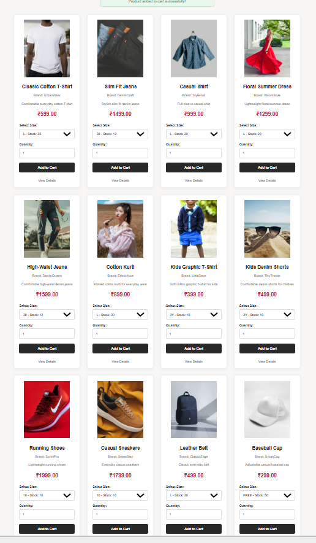
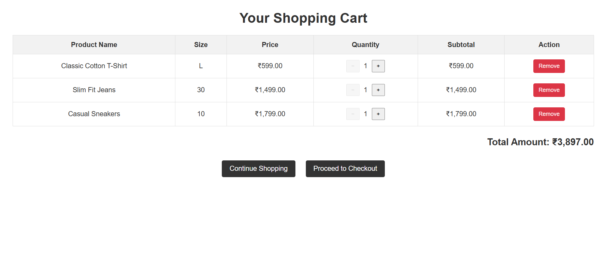

# FashionStore

A full-stack e-commerce web application for fashion products, built with Java Servlets, JSP and MySQL, following an MVC + DAO architecture.

> **Status:** work in progress. The core shopping flow (browse → cart → checkout → orders) works. See the roadmap below for what's coming next.

## Features

- User registration and login (passwords hashed with BCrypt)
- Product browsing with categories (Men, Women, Kids, Footwear, Accessories) and search
- Product variants (sizes) with live stock checks
- Shopping cart: add, update quantity, remove
- Checkout with delivery-details validation (Cash on Delivery)
- Transactional order placement (order, order items and cart clearing succeed or fail together)
- Order history and order details, visible only to the user who placed the order
- Responsive layout built with custom CSS

## Tech stack

| Layer      | Technology                                  |
|------------|---------------------------------------------|
| Language   | Java 21                                     |
| Web        | Jakarta Servlet 6.0, JSP 3.1, JSTL 3.0      |
| Database   | MySQL 8 (JDBC with `PreparedStatement`)     |
| Security   | jBCrypt for password hashing                |
| Build      | Maven (WAR packaging)                       |
| Server     | Apache Tomcat 10.1                          |

## Project structure

```
src/main/java/com/fashionstore
├── controller/   Servlets (request handling)
├── dao/          DAO interfaces
│   └── impl/     JDBC implementations
├── model/        Plain Java objects (User, Product, Order, ...)
└── util/         DBConnection
src/main/webapp
├── WEB-INF/views/   JSP pages and partials
└── assets/css/      Stylesheets
database/schema.sql  Tables + sample data
```

## Getting started

**Prerequisites:** JDK 21, Maven, MySQL 8, Tomcat 10.1

1. **Clone the repository**
   ```bash
   git clone https://github.com/BhoomikaVedamurthy/FashionStore.git
   cd FashionStore
   ```
2. **Create the database.** In MySQL Workbench open `database/schema.sql` and run it, or:
   ```bash
   mysql -u root -p < database/schema.sql
   ```
3. **Configure the database connection.** Copy `src/main/resources/db.properties.example` to `src/main/resources/db.properties` and enter your MySQL password. (Alternatively set the environment variables `DB_URL`, `DB_USER`, `DB_PASSWORD`.) `db.properties` is git-ignored.
4. **Build**
   ```bash
   mvn clean package
   ```
5. **Deploy** `target/FashionStore.war` to Tomcat 10.1's `webapps` folder (or run it from Eclipse/IntelliJ with a Tomcat 10.1 server), then open:
   `http://localhost:8080/FashionStore/home`

**Demo login:** `demo@example.com` / `Demo@1234` (or register a new account).

## Known limitations

- Payment is Cash on Delivery only; there is no online payment gateway yet.
- No CSRF tokens on forms yet.
- Product images are loaded from external URLs stored in the database.
- No admin panel; products are managed directly in the database.
- Automated tests are not set up yet (`src/test/java` has DAO check programs that need a running database).

## Roadmap

- [ ] Admin dashboard (manage products, stock and orders)
- [ ] Order cancellation
- [ ] Online payment integration
- [ ] CSRF protection and security headers
- [ ] JUnit tests
- [ ] Docker setup and cloud deployment

## Screenshots

### Homepage


### Product Details


### Shopping Cart

## Author

**Bhoomika M V** — [GitHub](https://github.com/BhoomikaVedamurthy) · [LinkedIn](https://www.linkedin.com/in/bhoomikamv)
